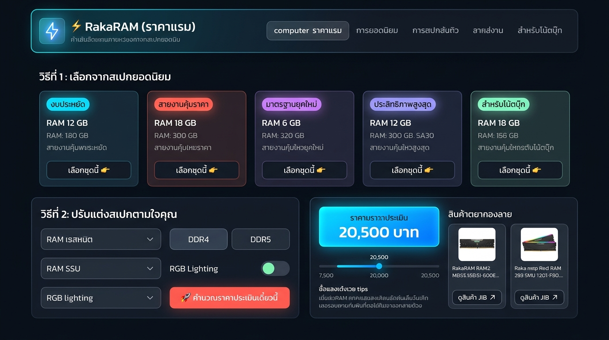
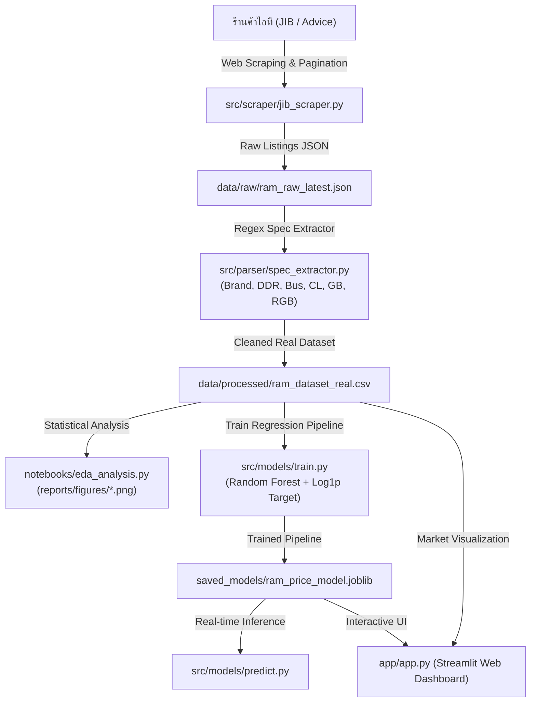

# ⚡ RakaRAM (ราคาแรม)

[](https://www.python.org/)
[]()
[]()
[](https://streamlit.io/)

**RakaRAM** คือระบบวิเคราะห์ตลาดและทำนายราคาแรมคอมพิวเตอร์ (RAM Price Analysis & Real-time Prediction) ที่สร้างขึ้นเพื่อดึงข้อมูลราคาและสเปกจริงจากร้านค้าไอทีชั้นนำในไทย นำมาผ่านกระบวนการ Data Pipeline, วิเคราะห์สถิติความคุ้มค่า (EDA), และฝึกโมเดล Machine Learning (Log-Transformed Regression) สำหรับประเมินราคาตามสเปกแบบ Real-time พร้อมแสดงผลผ่าน Interactive Web Dashboard ด้วย **Streamlit**



---

## 🏗️ สถาปัตยกรรมระบบ (System Architecture)



---

## 🚀 ฟีเจอร์หลัก (Key Features)

1. **Live Web Scraper & Auto-Pagination**: ดึงข้อมูลแรมแบบสดทั้งประเภท Desktop PC (UDIMM) และ Laptop (SO-DIMM) จากผู้จัดจำหน่ายจริงในไทย
2. **Regex Feature Extraction Engine**: สกัดสเปกละเอียดจากชื่อสินค้าภาษาไทย/อังกฤษ:
   - แบรนด์ (Corsair, Kingston, G.Skill, ADATA, KLEVV, Lexar, Crucial, ฯลฯ)
   - Generation (`DDR4`, `DDR5`)
   - ความจุรวม (GB) และจำนวนแถว (Modules เช่น `1x16GB`, `2x16GB`)
   - ความเร็วบัส (Speed MHz เช่น 2666, 3200, 5600, 6000, 7200)
   - ค่าความหน่วงเวลา (CAS Latency / CL)
   - ไฟประดับ (RGB Lighting)
3. **Exploratory Data Analysis (EDA)**: วิเคราะห์แนวโน้มราคา ความคุ้มค่าต่อ GB (Price/GB) และเปรียบเทียบระหว่างแบรนด์
4. **Machine Learning Real-time Predictor**:
   - ใช้โมเดล **Random Forest Regressor** ร่วมกับ **Log-Normal Target Transformation**
   - ให้ค่า **$R^2 = 0.9533$** บน Held-out Test Set และ **MAE ต่ำเพียง ±1,434 บาท**
   - ประเมินราคาขายที่เหมาะสม พร้อมช่วงราคาแนะนำ (Fair Price Range)
5. **Linear Regression Price Structure Analysis**:
   - ถอดรหัสโครงสร้างราคาตลาดจริงด้วยสถิติ OLS ($R^2 = 0.8739$)
   - คำนวณมูลค่าความจุ (+747 บ./GB), บัสสปีด (+469 บ./100MHz), ความหน่วง (-1,397 บ./CL) และแยกลาดชัน DDR4 (~289 บ./GB) vs DDR5 (~1,081 บ./GB)
6. **Global DRAM News Intelligence & Sentiment Analysis**:
   - ตรวจจับสัญญาณข่าวสารและอุปสงค์-อุปทานจากโรงงานชิปทั่วโลก (Samsung, SK Hynix, Micron)
   - สกัดแรงกระเพื่อมจากกระแส HBM/AI, การลดกำลังผลิตเวเฟอร์, และความก้าวหน้าของ Die Yield
   - ปรับจูนเส้นพยากรณ์ราคา 6 เดือนข้างหน้าแบบไดนามิกพร้อมแถบความผันผวน (Price Corridor)
7. **Interactive Streamlit Web Dashboard**:
   - แดชบอร์ดสรุปตัวเลขตลาดปัจจุบันแบบสด และเรดาร์ข่าวตลาดชิปโลก
   - เครื่องคำนวณและทำนายราคาแรมจากสเปกแบบ Real-time
   - ระบบ On-Demand Live Sync เพื่อสั่งดึงราคาสดและข่าวสารใหม่ได้ในคลิกเดียว

---

## 📊 ผลการทดสอบโมเดล (Model Benchmark)

ผลการทดสอบด้วย 5-Fold Cross Validation บนชุดข้อมูลราคาตลาดจริง:

| Model Architecture | Cross-Validation $R^2$ | Cross-Validation MAE | Test Set $R^2$ | Test Set MAE |
| :--- | :---: | :---: | :---: | :---: |
| **Random Forest (Log-Target)** 🏆 | **0.9023** | **2,744 THB** | **0.9533** | **±1,434 THB** |
| Gradient Boosting (Log-Target) | 0.8023 | 3,041 THB | 0.8841 | ±2,150 THB |
| Ridge Regression (Log-Target) | 0.7964 | 3,756 THB | 0.8245 | ±2,680 THB |

---

## 🛠️ การติดตั้งและเริ่มต้นใช้งาน

### 1. โคลนคลังข้อมูลและติดตั้ง Dependencies
```powershell
git clone https://github.com/YuttakanS/RakaRAM.git
cd RakaRAM
pip install -r requirements.txt
```

### 2. รัน Interactive Web Dashboard (Streamlit)
```powershell
streamlit run app/app.py
```
เปิดเบราว์เซอร์ที่ `http://localhost:8501` เพื่อใช้งานแดชบอร์ดและฟอร์มทำนายราคาแบบ Real-time

---

### 3. รัน Serverless REST API (FastAPI)
```powershell
python main.py
# หรือใช้ uvicorn โดยตรง
uvicorn main:app --reload --port 8000
```
เปิดเอกสาร Swagger API ได้ที่ `http://localhost:8000/docs` เพื่อทดสอบทำนายราคาผ่าน RESTful API (พร้อมรองรับการ Deploy สู่ Vercel / Cloud Run ผ่าน `vercel.json`)

---

### 4. รันคำนวณราคาผ่าน CLI (Real-time Prediction CLI)
```powershell
# ตัวอย่าง: ทำนายราคา Kingston DDR5 32GB (2x16GB) 6000MHz CL36 RGB
python -m src.models.predict --brand Kingston --gen DDR5 --capacity 32 --speed 6000 --modules 2 --cl 36 --rgb 1

# ตัวอย่าง: ทำนายราคา Corsair DDR4 16GB (2x8GB) 3200MHz CL16 Non-RGB
python -m src.models.predict --brand Corsair --gen DDR4 --capacity 16 --speed 3200 --modules 2 --cl 16 --rgb 0
```

---

### 4. ซิงค์ข้อมูลราคาตลาดใหม่ (Run Data Pipeline)
```powershell
python -m src.scraper.run_pipeline
```

### 5. รันการวิเคราะห์ข้อมูลและสร้างกราฟ (EDA)
```powershell
python notebooks/eda_analysis.py
```

### 6. เทรนโมเดลใหม่ (Model Training & Evaluation)
```powershell
python -m src.models.train
```

---

## 📁 โครงสร้างโปรเจกต์ (Project Directory)

```text
RakaRAM/
├── data/
│   ├── raw/                        # ข้อมูลดิบที่สแครปมาจากร้านค้า (JSON Snapshots)
│   ├── processed/                  # ชุดข้อมูลจริงที่ผ่านการสกัดสเปก (ram_dataset_real.csv)
│   └── news/                       # ข้อมูลข่าวสารตลาดชิปและผลวิเคราะห์ Sentiment
├── src/
│   ├── scraper/                    # โมดูล Web Scraper (JIB Scraper, Pipeline Runner)
│   ├── parser/                     # Regex Spec Extractor (แยก brand, DDR, Bus, CL, RGB)
│   ├── news/                       # โมดูล News Fetcher & Sentiment Impact Analyzer
│   ├── models/                     # ML Model Training & Real-time Predictor
│   └── utils/                      # Logging & Utilities
├── notebooks/                      # สคริปต์ EDA และ Linear Regression Analysis
├── reports/
│   └── figures/                    # กราฟิกชาร์ตสรุปสถิติตลาดแรม (.png)
├── saved_models/                   # โมเดล ML ที่บันทึกไว้ (.joblib และ metadata .json)
├── app/
│   └── app.py                      # Interactive Web Dashboard (Streamlit)
├── tests/                          # Automated Unit Tests
├── requirements.txt                # รายการไลบรารีที่จำเป็น
└── README.md
```

---

*พัฒนาและดูแลโดย [YuttakanS](https://github.com/YuttakanS)*
